<div align="center">

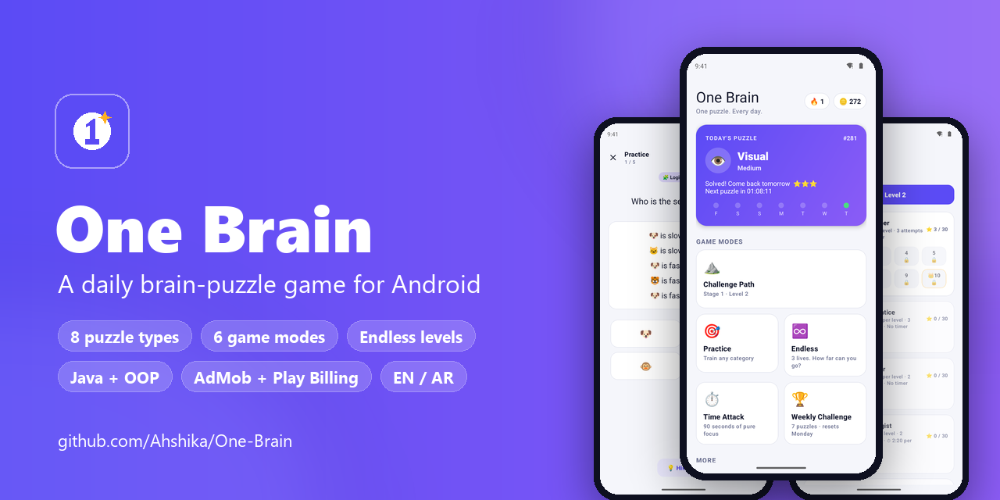

# One Brain 🧠

**One puzzle. Every day.**<br>
A brain-puzzle game for Android: a daily puzzle that's the same for every player, plus an endless Challenge Path that keeps getting harder.


[**⬇ Download the APK**](https://github.com/Ahshika/One-Brain/releases/latest)

</div>

## Screenshots

<p align="center">
  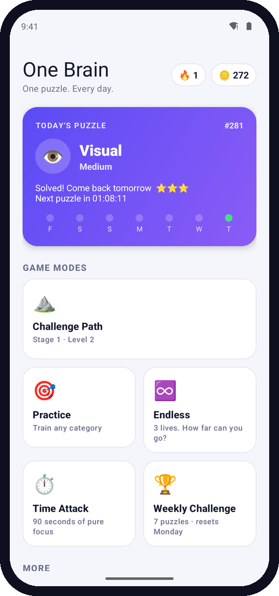
  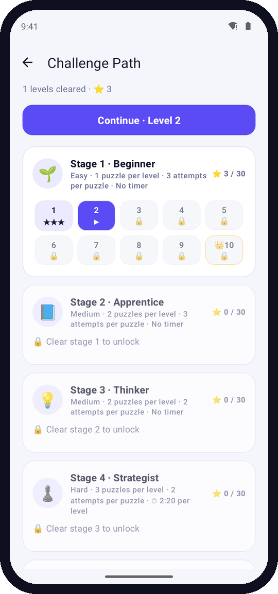
  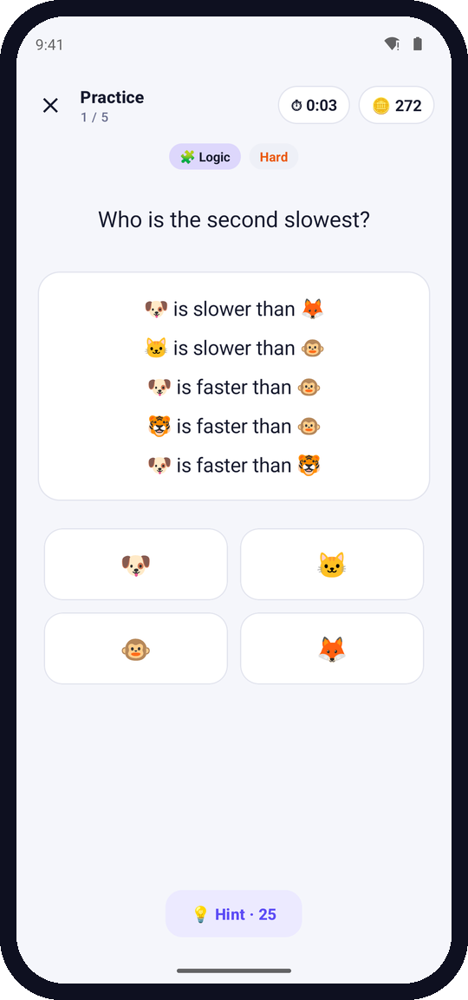
  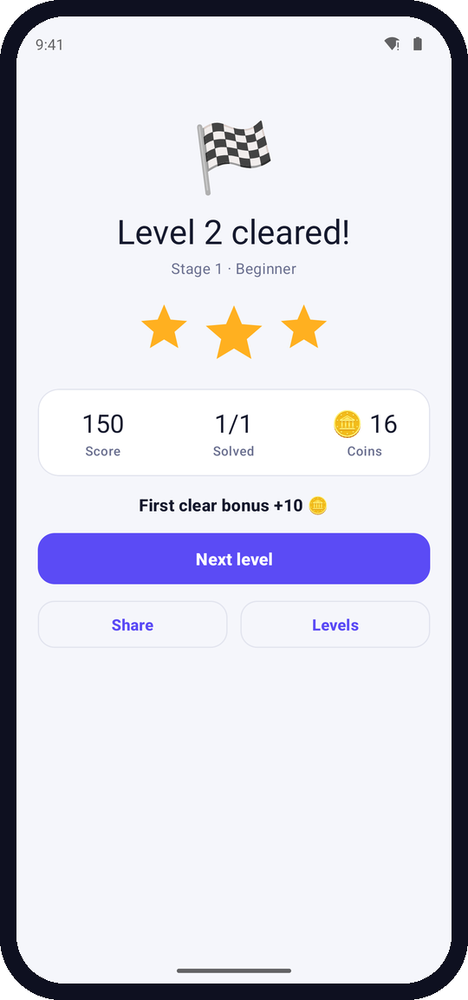
</p>
<p align="center">
  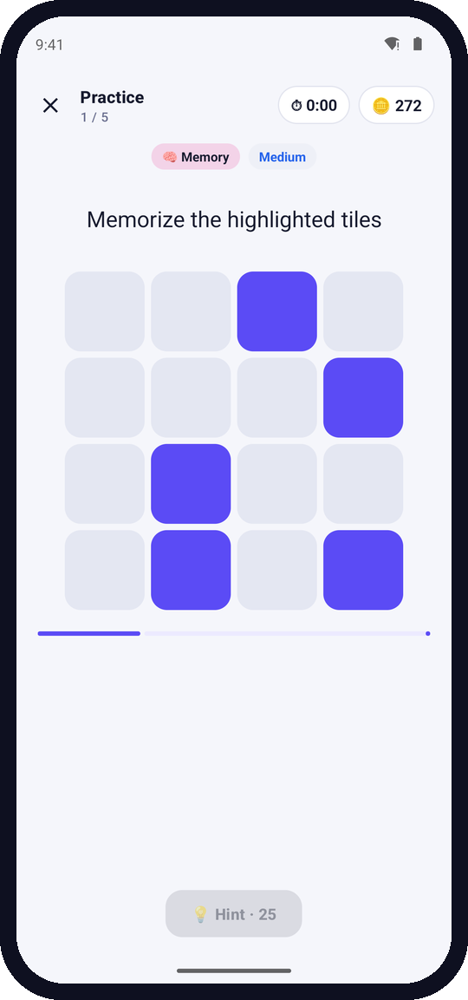
  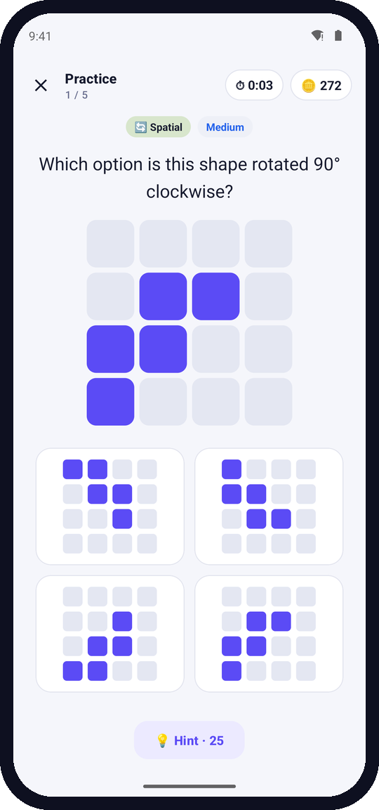
  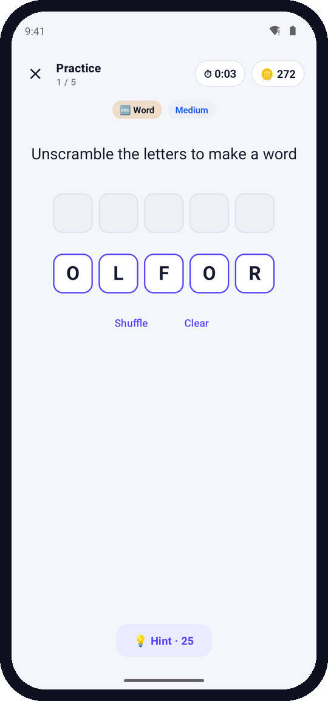
  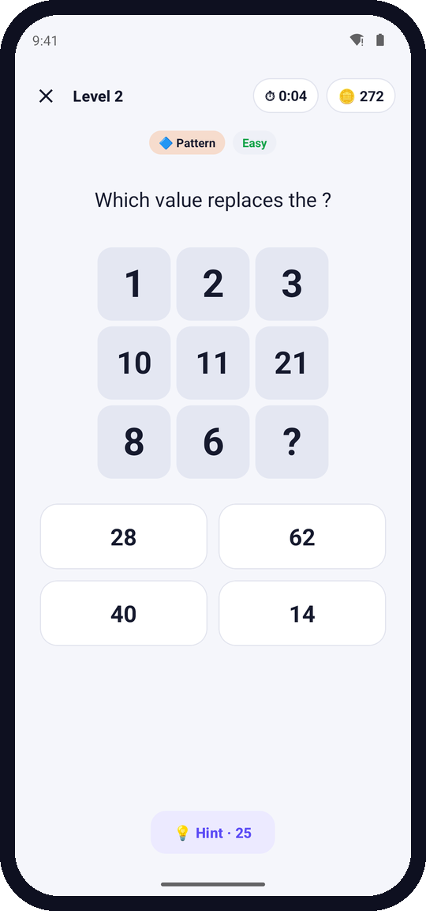
</p>
<p align="center">
  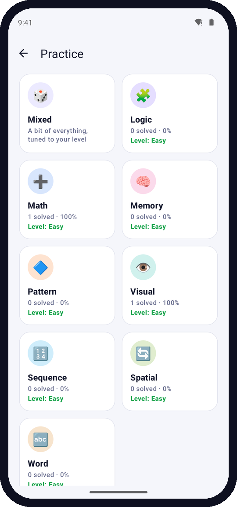
  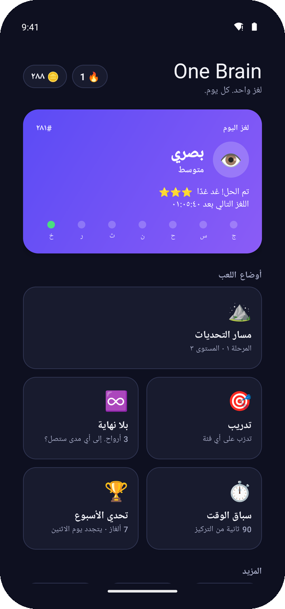
  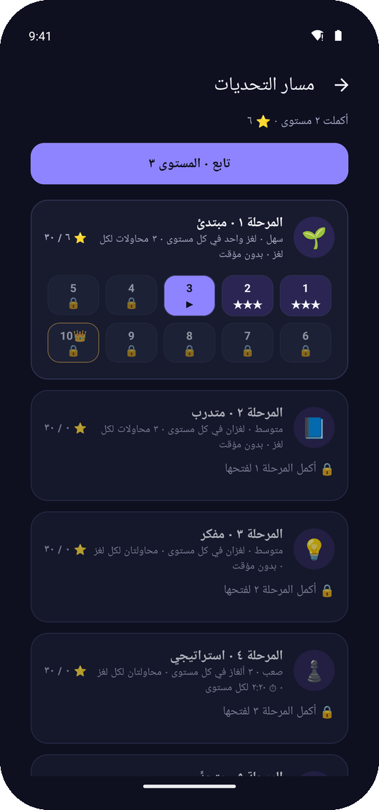
</p>

## Features

- **Daily Puzzle:** the same puzzle for every player on the same day (generated from the date, no server). Streaks, streak freezes and spoiler-free sharing (`🧠 One Brain #281 ⭐⭐⭐ ⏱ 0:42`).
- **Challenge Path:** endless levels in stages of 10. Each stage adds harder puzzles, more puzzles per level, fewer attempts, a clock, then no hints. Every 10th level is a 👑 boss. After stage 10 **the game creates its own stages**, each with a generated theme (focus categories, *Sprint* or *Marathon* rules).
- **8 puzzle types:** Logic · Math · Memory · Pattern · Visual · Sequence · Spatial · Word, all generated procedurally, so content never runs out.
- **5 difficulties:** Easy → Medium → Hard → Expert → Master, with adaptive difficulty per category.
- **More modes:** Practice, Endless (3 lives), Time Attack (90 s), Weekly Challenge (7 shared puzzles), Puzzle Packs.
- **Progression:** stars, coins, 21 achievements, detailed statistics per category.
- **Monetization:** AdMob (banner, interstitial, rewarded) behind a polite frequency cap + GDPR consent (UMP); Google Play Billing 8 for Remove Ads, coin packs and puzzle packs.
- **Polish:** Material 3, light/dark themes, full Arabic RTL + English, sound effects, haptics, animations; works offline.

## Build & run

Open the project in Android Studio (JDK 17), or:

```bash
./gradlew assembleDebug          # debug APK (Google test ads)
./gradlew testDebugUnitTest      # 41 unit tests, incl. fuzzing 20,000 generated puzzles
./gradlew bundleRelease          # Play Store .aab (R8-shrunk, ~4 MB APK)
```

Toolchain: AGP 8.13.1 · Gradle 8.14.3 · compileSdk/targetSdk 36 · minSdk 26.

---

## Project structure

```
app/src/main/java/com/onebrain/game/
├── OneBrainApp.java                 Application: boots GameManager, applies theme
├── core/          ── game rules & orchestration (pure Java except GameManager)
│   ├── GameManager.java             Facade composing every subsystem
│   ├── DailyPuzzleManager.java      Picks today's identical-for-everyone puzzle
│   ├── WeeklyChallengeManager.java  7 shared puzzles per ISO week
│   ├── DifficultyManager.java       Adaptive difficulty per category
│   ├── PackManager.java / PuzzlePack.java   Seeded level packs + unlock rules
│   ├── Difficulty, PuzzleCategory, GameMode (enums)
│   └── DateProvider, SystemDateProvider, DayClock   Testable calendar logic
├── puzzle/        ── the puzzle model (no Android imports)
│   ├── Puzzle.java                  Abstract root
│   ├── ChoicePuzzle.java            Abstract: multiple-choice + "remove option" hint
│   ├── MathPuzzle, LogicPuzzle, PatternPuzzle, SequencePuzzle, SpatialPuzzle
│   ├── MemoryPuzzle, VisualPuzzle, WordPuzzle
│   ├── Hintable, Memorizable        Capability interfaces
│   ├── Prompt/PromptKey, Option, ChoiceSet, Hint, InputType, ShapeTransform
│   ├── answer/   Answer, ChoiceAnswer, CellsAnswer, TextAnswer
│   └── visual/   Visual, TextVisual, LinesVisual, GridVisual, VisualVisitor
├── generator/     ── procedural content
│   ├── PuzzleGenerator.java         Strategy interface
│   ├── BasePuzzleGenerator.java     Shared helpers (ranges, distractors)
│   ├── 8 × <Category>PuzzleGenerator.java
│   ├── WordBank.java                Curated word lists, anagram index
│   └── PuzzleFactory.java           Registry: category → generator
├── session/       ── game modes
│   ├── GameSession.java             Abstract mode
│   ├── DailySession, PracticeSession, EndlessSession, TimeAttackSession,
│   │   WeeklySession, PackSession
│   ├── SessionFactory, SessionConfig, SessionProgress, SessionResult
├── player/        Player, Wallet, Inventory, PlayerStats, CategoryStats
├── score/         ScoreManager, ScoreResult
├── achievement/   Achievement, StatAchievement, SpeedAchievement, AchievementManager
├── data/          Persistable, SaveManager, SettingsManager
├── audio/         SoundManager, HapticManager
├── monetization/  AdManager, AdPolicy, BannerController, ConsentManager,
│                  BillingManager, ProductCatalog, PurchaseVerifier
├── ui/
│   ├── base/BaseActivity            Edge-to-edge insets, toolbar, feedback helpers
│   ├── home/MainActivity            Splash, daily card, modes, navigation
│   ├── game/PuzzleActivity + GameViewModel
│   ├── game/render/                 PuzzleRenderer + Choice/Memory/OddOneOut/Word renderers,
│   │                                VisualViewFactory, RendererFactory
│   ├── view/GridBoardView           Custom Canvas view for every grid
│   ├── result/ResultActivity, ShareTextBuilder
│   ├── categories/, stats/, achievements/, packs/, shop/, settings/
│   └── common/                      UiText (model → resources), Anim, Navigator, Sections
└── util/          SeedUtil, Stopwatch, Event, TimeFormat, ColorUtil
app/src/main/res/  layouts, values (+ values-ar, values-night, values-sw600dp),
                   drawables, adaptive icon, raw/ sound effects
app/src/main/assets/privacy_policy.html   Privacy policy placeholder
app/src/test/      Unit tests
```

### Layer separation

| Layer | Packages | Android-free? |
|---|---|---|
| Game logic | `puzzle`, `generator`, `session`, `score`, `achievement`, most of `core` | ✅ fully unit-tested on the JVM |
| Data | `player` | ✅ (uses `org.json`) |
| Persistence | `data` | SharedPreferences |
| Monetization | `monetization` | AdMob, UMP, Play Billing |
| Audio | `audio` | SoundPool, haptics |
| UI | `ui` | Activities, ViewModel, custom views |

---

## Major classes and responsibilities

### Core
- **GameManager**: an application-scoped facade built by **composition**. It owns SaveManager, SettingsManager, Player, PuzzleFactory, ScoreManager, AchievementManager, Daily/Weekly managers, SoundManager, AdManager and BillingManager. It records puzzle results, finishes sessions (best scores, achievements, saving) and grants purchases. It holds only the Application context, so it cannot leak an Activity.
- **DailyPuzzleManager**: derives category, difficulty and seed **only from the calendar date**, so every player gets the same puzzle (#N) on the same day. Each 8-day block contains every category exactly once. Difficulty climbs through the week (Mon/Tue Easy … Sun Expert).
- **WeeklyChallengeManager**: 7 shared puzzles per ISO week, escalating Easy → Expert.
- **DifficultyManager**: a player moves to the next level in a category after 4 solves at ≥70% accuracy at the current level.
- **PackManager / PuzzlePack**: seeded level packs (free Starter; paid Math Master, Memory Marathon, Word Wizard; Grandmaster included with Premium). Levels cost 0 bytes of APK.

### Challenge Path (open, level-based, endless)
- **ChallengePath**: a never-ending campaign of levels grouped into stages of 10. Each stage tightens the rules:

| Stage | Name | Difficulty | Puzzles/level | Attempts | Timer | Hints |
|---|---|---|---|---|---|---|
| 1 | Beginner | Easy | 1 | 3 | – | ✓ |
| 2 | Apprentice | Easy→Medium | 2 | 3 | – | ✓ |
| 3 | Thinker | Medium | 2 | 2 | – | ✓ |
| 4 | Strategist | Medium→Hard | 3 | 2 | 2:30 | ✓ |
| 5 | Challenger | Hard | 3 | 2 | 2:10 | ✓ |
| 6 | Expert | Hard→Expert | 3 | 2 | 2:10 | ✓ |
| 7 | Mastermind | Expert | 3 | 1 | 2:00 | ✓ |
| 8 | Genius | Expert→Master | 4 | 1 | 2:30 | ✗ |
| 9 | Legend | Master | 4 | 1 | 2:20 | ✗ |
| 10 | One Brain | Master | 5 | 1 | 2:40 | ✗ |
| 11+ | Infinity N | Master | 5 | 1 | −5 s per stage (min 1:15) | ✗ |

  The clock also tightens 2 s per level inside a stage. Every 10th level is a 👑 boss (one extra puzzle, all at the harder tier, +30 s). Levels are generated from their index, so level N is identical for everyone.
- **ChallengeLevel**: the immutable rules and content of one level. **ChallengeSession** (a `GameSession`): one failed puzzle or running out of time fails the level; a clear unlocks the next level and pays a first-clear coin reward (×5 for bosses). **ChallengeProgress** (in `PlayerStats`): highest unlocked level and best stars per level.
- **Master** difficulty (new 5th tier: bigger boards, 8-letter words, two-variable systems, harder rules) appears from stage 8. Free players unlock Expert practice at path level 50 and Master practice at level 80; Premium unlocks both.
- `ui/path/ChallengePathActivity`: the stage map with level tiles, stars and locks, and a "Continue" button. Five new achievements (10/50/100 levels, 150 path stars, 10 Master solves).

### Puzzle model (inheritance, abstraction, polymorphism)
- **Puzzle** (abstract): category, difficulty, seed, prompt, visual. `check(answer)` is a *template method* that calls the subclass's `evaluate()` and `onWrongAnswer()` hook. Subclasses override `getParSeconds()`.
- **ChoicePuzzle** (abstract): options and validation, plus the "remove a wrong option" hint. It remembers wrong picks so hints skip them.
  - **MathPuzzle**: missing operands, order of operations, linear equations, small systems.
  - **LogicPuzzle**: symbol algebra (🍎 + 🍌 = …) and ranking deductions (who is fastest?).
  - **PatternPuzzle**: 3×3 Latin squares or number matrices with a hidden rule. The generator rejects matrices where a second rule would also fit.
  - **SequencePuzzle**: arithmetic, geometric, Fibonacci, interleaved, cubes, primes and more.
  - **SpatialPuzzle**: rotation and reflection of an asymmetric polyomino (all 8 symmetries distinct).
- **MemoryPuzzle** (`Memorizable`): study the tiles, then recall them.
- **VisualPuzzle**: odd-one-out by color shade or look-alike symbol.
- **WordPuzzle**: an anagram; any listed anagram of the word counts as correct.
- **Hintable / Memorizable**: capability interfaces, so the UI asks "can it hint?" rather than "what class is it?".
- **Visual + VisualVisitor**: the UI turns visuals into Views through the Visitor pattern, so the model never imports Android.
- **Prompt / PromptKey**: localizable text as key + args. `ui.common.UiText` maps keys to string resources, which is how the game logic stays language-neutral.

### Generators
- **PuzzleGenerator** (Strategy interface) is implemented by one generator per category. **PuzzleFactory** is the registry: adding a category means writing one class and registering it. Every generator is a pure function of `(difficulty, seed)` using `java.util.Random`, whose algorithm is fixed by the Java spec. That determinism is what makes daily and weekly puzzles identical on all devices, and lets a session be rebuilt after process death from its seed alone.

### Sessions (game modes)
- **GameSession** (abstract) defines the API the ViewModel drives for every mode: `getCurrentPuzzle`, `getAttemptsPerPuzzle`, `getMaxLives`, `getTimeLimitMillis`, `isOver`, and the `onCompleted` hook.

| Session | Rules |
|---|---|
| DailySession | 1 puzzle, 3 attempts, updates streak / history |
| PracticeSession | 5 puzzles, chosen or adaptive difficulty |
| EndlessSession | 3 lives, difficulty ramps every 4 solves |
| TimeAttackSession | 90 s, −5 s per mistake, no hints, no memory puzzles |
| WeeklySession | 7 escalating shared puzzles |
| PackSession | 1 level; solving unlocks the next |

- **SessionConfig** (Serializable) holds everything needed to rebuild a session. **SessionProgress** holds the running totals and is saved into SavedStateHandle. **SessionResult** is the immutable summary shown on the results screen (built with a Builder).

### Player & progression
- **Player** is composed of **Wallet** (coins), **PlayerStats** and **Inventory** (purchases, packs, streak freezes).
- **PlayerStats** tracks: current/longest streak, total played/solved, accuracy, average and fastest time, flawless run, 3-star count, best score per mode, best Endless/Time Attack runs, weekly progress, 60-day daily history, and per-category **CategoryStats** broken down by difficulty. Streak freezes automatically bridge missed days.
- **ScoreManager**: score = base(difficulty) × speed (relative to par time) × hint penalty × mistake penalty. Stars reward fast, clean solves; coins scale with stars and difficulty (×3 for the daily).
- **Achievement** (abstract) has two subclasses: **StatAchievement** (any counter, read through a lambda) and **SpeedAchievement**. **AchievementManager** defines 16 achievements, including the required "7 daily puzzles", "30 puzzles", "10 in a row without an error" and "under 10 seconds". It unlocks each one once and pays a coin reward.

### Persistence
- **Persistable** is the interface implemented by Player, Wallet, Inventory, PlayerStats and CategoryStats. Loading tolerates missing keys, so old saves keep working after updates.
- **SaveManager** stores the profile as one small JSON document in SharedPreferences with async `apply()`. It is included in Android Auto Backup (`xml/backup_rules.xml`, `xml/data_extraction_rules.xml`).
- **SettingsManager**: sound, vibration, timer visibility, and theme (System/Light/Dark via AppCompatDelegate).

### Audio
- **SoundManager**: one small SoundPool with 6 OGG clips (~30 KB total). An idle pool uses no CPU.
- **HapticManager**: `View.performHapticFeedback` (CONFIRM/REJECT on API 30+). No VIBRATE permission needed, and it respects the system setting.

### Monetization
- **AdManager** handles UMP consent, then initializes MobileAds off the main thread and preloads ads. **AdPolicy** keeps ads polite: no interstitial in the first sessions, then at most one every 3 sessions and 4 minutes, and only *between* sessions, never during a puzzle. Rewarded ads are always optional (free hint, double coins, +50 coins up to 5×/day) and stay available after Remove Ads.
- **BannerController**: a lifecycle-aware adaptive banner, shown only on Home and Results. It is removed as soon as Remove Ads is owned.
- **ConsentManager**: the GDPR/US-state consent form, plus a Privacy Options entry in Settings when required.
- **BillingManager** (Play Billing 8): reconnects with backoff, queries products, launches purchases, acknowledges non-consumables, consumes coin packs (coins are granted only after consumption succeeds, so never twice), handles pending purchases, and restores purchases.
- **ProductCatalog**: product ids. **PurchaseVerifier**: optional RSA signature check.

### UI
- **GameViewModel** survives rotation and drives the session (stopwatch, attempts, hints, transitions). It mirrors config, progress and timer into **SavedStateHandle**, so after process death the same puzzle is regenerated from its seed. The daily timer is also stored on disk, so leaving the app doesn't reset it.
- **PuzzleActivity** is thin: it wires the ViewModel to a **PuzzleRenderer** and plays feedback (sound, haptics, animations).
- **PuzzleRenderer** (interface) has 4 implementations chosen by **RendererFactory** from the puzzle's `InputType`: Choice, Memory, OddOneOut and Word. This mirrors the puzzle hierarchy on the UI side.
- **GridBoardView**: a single custom Canvas view draws every grid, which is much cheaper than dozens of child views on low-end phones.
- Activity-per-screen: Main, Puzzle, Result, Categories, Stats, Achievements, Packs, Shop, Settings, PrivacyPolicy.

### Performance & lifecycle
- The timer ticks only while the screen is visible (250 ms); the home countdown ticks only while resumed. Everything pauses in `onPause`.
- No Activity references are held by long-lived objects. Handlers are cleared in `onDestroy`/`onCleared`, and AdViews and WebView are destroyed.
- Saving is asynchronous. Ads initialize off the main thread. There are no heavy images; icons are vectors and emoji.

---

## Testing on real phones

Download the signed APK from [**Releases**](https://github.com/Ahshika/One-Brain/releases/latest) (R8-shrunk, Google *test* ads), copy it to a phone and install it (allow "Install unknown apps"), or:

```bash
adb install -r OneBrain-1.0.0.apk
```

Notes:
- Ads are Google's test ads, so it is safe to tap them.
- In-app purchases only work when the app is installed from Google Play (internal testing track + license testers). A sideloaded APK shows "Store unavailable".
- To sign your own release builds, copy `keystore.properties.example` → `keystore.properties` (git-ignored) and point it at your keystore.

## Google Play release checklist

1. **Package name:** `com.onebrain.game` (change `applicationId`/`namespace` in `app/build.gradle` if needed).
2. **Signing:** create an upload key, copy `keystore.properties.example` → `keystore.properties` and fill it in. Use Play App Signing.
3. **Versioning:** bump `versionCode` (integer, every upload) and `versionName` in `app/build.gradle`.
4. **AdMob:** create the app and 3 ad units (adaptive banner, interstitial, rewarded), then set them in `~/.gradle/gradle.properties` or `local.properties`:
   ```
   ONEBRAIN_ADMOB_APP_ID=ca-app-pub-…~…
   ONEBRAIN_ADMOB_BANNER_ID=ca-app-pub-…/…
   ONEBRAIN_ADMOB_INTERSTITIAL_ID=ca-app-pub-…/…
   ONEBRAIN_ADMOB_REWARDED_ID=ca-app-pub-…/…
   ```
   Without them, release builds fall back to Google's **test** IDs, which is safe but earns nothing. Set up the GDPR/US-state messages in AdMob → Privacy & messaging, and add `app-ads.txt` to your website.
5. **Billing:** in Play Console → Monetize → In-app products, create `remove_ads`, `premium_pack`, `pack_math_master`, `pack_memory_marathon`, `pack_word_wizard` (one-time) and `coins_500`, `coins_1500`, `coins_4000` (consumable). Optionally set `ONEBRAIN_PLAY_LICENSE_KEY` to enable signature checks. For strong protection, verify purchase tokens on a server.
6. **Privacy policy:** fill in `assets/privacy_policy.html`, host it publicly, and link it in the Play Console. Complete the Data safety form (AdMob collects device IDs and diagnostics) and declare "Contains ads".
7. **Store listing assets:** a 512×512 icon (export from `ic_launcher_foreground` with Android Studio → Image Asset), a 1024×500 feature graphic, and screenshots.
8. `./gradlew bundleRelease` → upload `app/build/outputs/bundle/release/app-release.aab` to internal testing first.

## Extending
- **New puzzle category:** add an enum value, a `Puzzle` subclass (or reuse `ChoicePuzzle`), a `PuzzleGenerator`, register it in `PuzzleFactory`, and add strings and an icon in `UiText`.
- **New language:** add `res/values-xx/strings.xml` and the locale in `res/xml/locales_config.xml`. Word puzzles currently use English words (`WordBank`).
- **Ideas:** daily reminder notification (WorkManager), Play Games leaderboards, cloud save.
